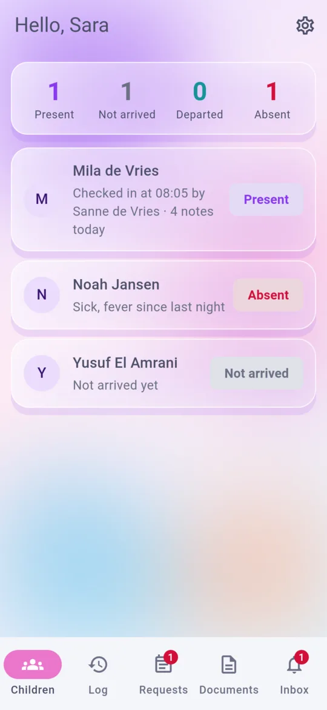
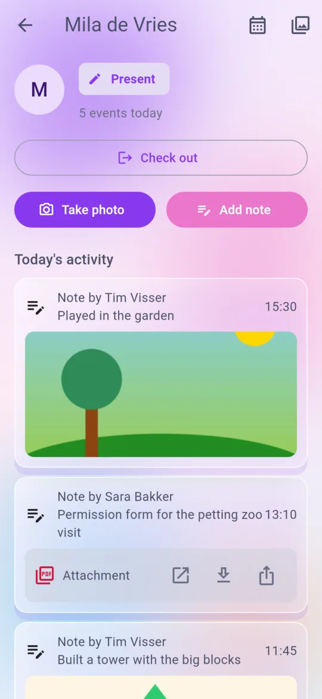
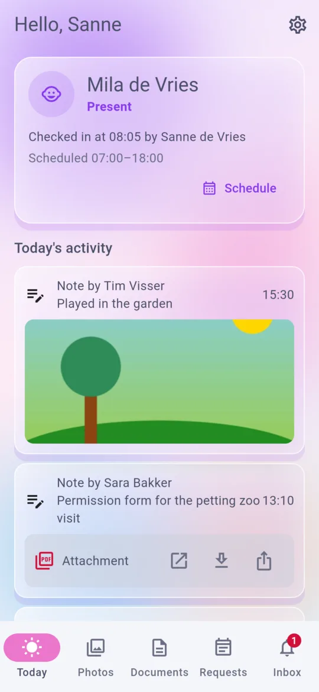
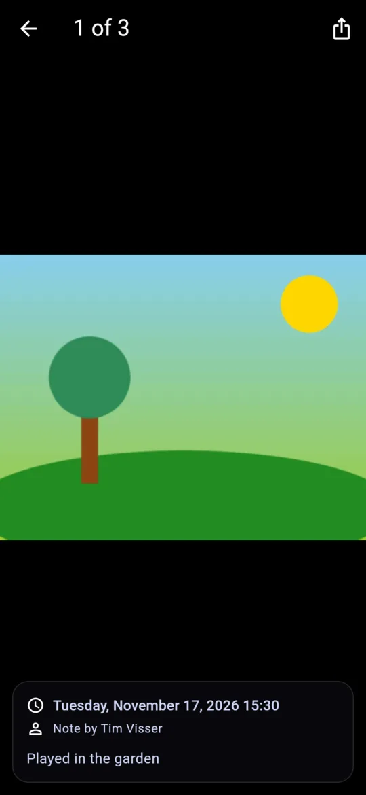
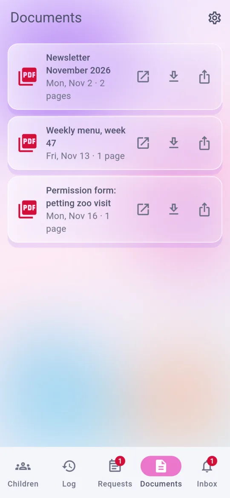
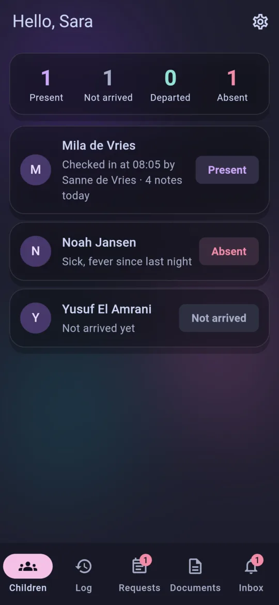
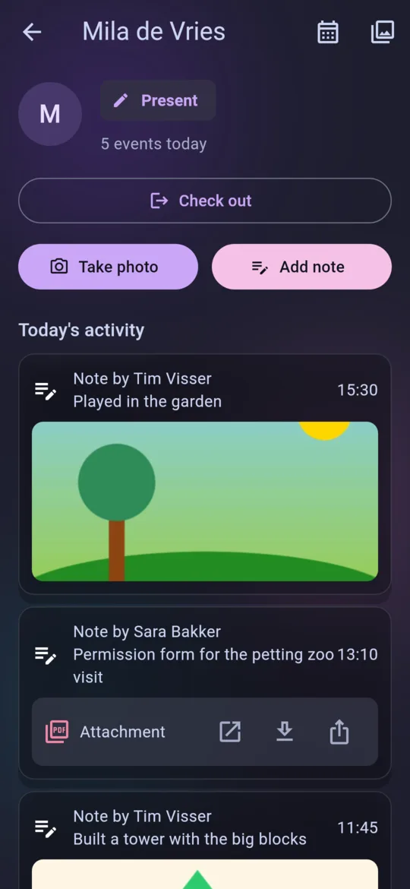
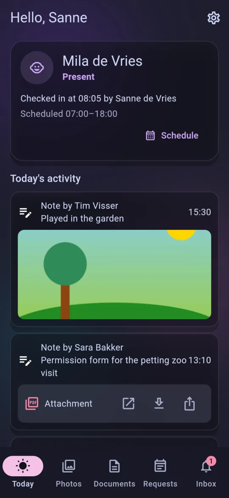
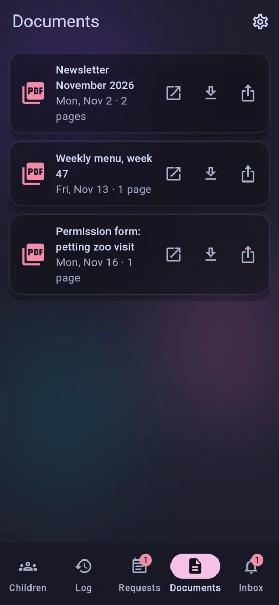

# DayCheck

A daycare administration app in Flutter, built with Riverpod and an MVVM
architecture from the start. Staff check children in and out and share
the day with parents; parents follow along, get notified, and send leave
or extra-hours requests.

Documentation (architecture, features, design, stack):
https://adam-bouafia.github.io/daycheck/

Test accounts: `sara` / `sara123` (staff) and `amina` / `amina123`
(parent); all of them are listed on the login screen.

<p>
    
</p>
<p>
    
</p>

Every screen in light and dark mode: https://adam-bouafia.github.io/daycheck/screens/

## What it does

- **Roster**: every child with today's status (not arrived, present,
  picked up, absent), derived from the log of check-in/check-out events, never
  stored separately.
- **Check in / check out**: records who dropped the child off or picked
  them up, and when.
- **Take photo**: staff open the camera straight from a child's screen;
  the photo goes only to that child's own parents.
- **Absent**: staff mark a child absent with a reason. Every guardian is
  notified on arrival, pick-up and absence, so separated parents on two
  accounts both know where their child is. Before the child arrives, the
  parent screen says "Expected at 07:00, not checked in yet".
- **Documents**: a newsletter, a weekly menu and a permission form
  (mock PDFs) to open in the phone's viewer, download through the save
  dialog, or share. PDFs in the feed get the same three buttons.
- **Activity notes**: staff post what a child did, with an optional photo
  (the note is its caption) and an optional PDF (a form, a menu, a
  newsletter). Parents open the PDF in their own viewer or share it.
- **Photo viewer**: tap any photo, in the feed or the gallery, for a
  full-screen view. Swipe between photos, pinch to zoom, and read when it
  was taken, by whom, and its description.
- **Photo gallery** per child, built from the same event log as the feed,
  so a photo in the log is always in the gallery too.
- **Notifications inside the app**: a bell with an unread count opens a
  list of every activity and request update, kept on the device, so
  nothing is lost when a pop-up is swiped away. Parents only see entries
  about their own children.
- **Pop-ups you control**: Settings has separate switches for activity
  and request pop-ups; the in-app list gets every entry either way.
- **Requests**: a parent asks for leave or extra hours on a date; staff
  approve or cancel. Every decision lands in the parent's notifications.
- **Schedule calendar** per child: a month view with the days they attend
  and the hours for the selected day.
- **Login with test accounts** (2 staff, 5 parents; listed on the login
  screen). The session survives an app restart; only the username is
  stored.
- **Two separate apps in one**: staff get the daycare home (attendance
  count, every child, check in/out, post notes, photos and PDFs, the day's
  log, approve requests). Parents get the family home (where their child
  is right now, today's feed, photos, their requests). Not one screen
  with parts hidden.
- **Nine languages**: Dutch, English, French, Polish, German, Turkish,
  Italian, Hebrew and Arabic, switchable in the app. Hebrew and Arabic
  lay the whole app out right to left.
- **Light, dark or system theme**, glassmorphism in both.
- **Older phones**: runs on Android 7.0 (API 24) and up, the lowest
  Flutter supports. A "Reduce effects" switch replaces the blurred glass
  with solid panels, and photos decode at thumbnail size in lists.
- **Local first**: everything is stored on the device. No backend and no
  account, the same choice as my other Flutter app,
  [MetJou](https://github.com/adam-bouafia/metjou).

## Architecture

Feature-first, with MVVM inside each feature: `data/` is the Model,
`*_viewmodel.dart` is the ViewModel (a Riverpod `Notifier`), and screens
and widgets are the View (`ConsumerWidget`).

```text
lib/
  main.dart              MaterialApp: theme, locale and effects from Settings
  core/
    theme/               Catppuccin Latte (light) and Mocha (dark)
    widgets/glass.dart   GlassPanel, GlassBackground, GlassEffects
    localization/        context.l10n, strings for code with no context
    notifications/       local pop-up notifications
  l10n/                  app_<lang>.arb for nine languages + generated code
  features/
    roster/              children, events, schedules, photos, PDFs
      data/              Child, DayEvent, Schedule, status rule, repository
      presentation/      roster, child detail, daily log, calendar,
                         gallery, photo viewer, and their ViewModel
    requests/            leave and extra-hours requests
    inbox/               the in-app notification list
    settings/            language, theme, pop-ups, reduce effects
    session/             test accounts, login, the saved session
    home/                staff home and parent home (bottom tabs), the
                         gate that picks one after login
```

Every repository is injected through a Riverpod provider, so tests swap
in in-memory fakes and never touch device storage or the file system.

## Design decisions

- **One event log for attendance and the feed.** Status, the feed, the
  gallery and the daily log are all views of the same list of events, so
  they can't disagree.
- **Screens watch state.** Every screen rebuilds from its ViewModel's
  state with `ref.watch`; there is no refresh button because nothing can
  go stale.
- **Notifications are stored, not just shown.** Each one lands in the
  in-app list with per-account read state; the pop-up is optional per
  kind.
- **Strings through `gen-l10n`,** with each language's own plural rules
  (Polish, Arabic and Hebrew have more than two forms).

## Not built

**Chat** between staff and parents is its own problem (delivery, read
receipts, presence). **Admin** (billing, staff rosters, organisation
settings) is a third role, not modelled here. **Push between two phones**
needs a server; the local pop-up shows the mechanism, and the in-app list
is the part that would stay the same with a backend behind it.

## Running it

```bash
flutter pub get
flutter run
```

## Tests

```bash
flutter test
```

62 tests: login (wrong password, saved session), the status and schedule rules as pure logic, every ViewModel
with fake repositories (check-in/out, notes with photos and PDFs,
requests, inbox, settings), the pop-up switches, language fallback,
widget tests that log in as staff and as a parent and drive each home, and rendering in Dutch,
Arabic and Hebrew (including right-to-left layout).

## CI

`.github/workflows/ci.yml` runs `dart format`, `flutter analyze` and
`flutter test`, and builds the documentation with `mkdocs build --strict`,
on every push to `main` and every pull request.
