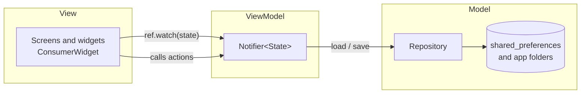
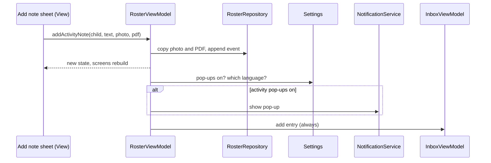

# Architecture

## MVVM, feature first

The code is split by feature first, and each feature is split by layer:

| Layer | Folder | Role |
| --- | --- | --- |
| Model | `features/<feature>/data/` | Plain Dart classes and the repository that loads and saves them. No Flutter widgets. |
| ViewModel | `features/<feature>/presentation/*_viewmodel.dart` | A Riverpod `Notifier` that holds the feature's state and exposes the actions the View can call. |
| View | `features/<feature>/presentation/*_screen.dart` and `widgets/` | `ConsumerWidget`s that watch the ViewModel and call its methods. No business rules. |

Feature-first keeps everything about one feature in one place: a change
to requests touches `features/requests/` and nothing else. The layers
inside it keep the rules testable without a widget tree.



### Compared with MVC and MVP

- In **MVC** the controller updates the view directly, so the two know
  about each other.
- In **MVP** the presenter holds a reference to a view interface and
  calls it to update the screen.
- In **MVVM** the ViewModel does not know the View exists. It exposes
  state; the View subscribes to it. That fits Flutter well, because a
  widget is already a function of state, and Riverpod's `ref.watch`
  rebuilds exactly the widgets that read the state that changed.

## Folder layout

```text
lib/
  main.dart                 MaterialApp; theme, locale and effects come from Settings
  core/
    theme/app_theme.dart    Catppuccin Latte and Mocha colour schemes
    widgets/glass.dart      GlassPanel, GlassBackground, GlassEffects
    localization/           context.l10n; localizationsFor() for code with no context
    notifications/          NotificationService (local pop-ups)
  l10n/                     app_<lang>.arb (nine languages) and the generated classes
  features/
    session/                Role, SessionViewModel, sign-in screen
    roster/
      data/                 Child, DayEvent, Schedule, status rule, RosterRepository
      presentation/         RosterViewModel; roster, child detail, daily log,
                            calendar, gallery and photo viewer screens; sheets
    requests/
      data/                 LeaveRequest, RequestRepository
      presentation/         RequestsViewModel, requests screen, new-request sheet
    inbox/
      data/                 InboxItem, InboxRepository
      presentation/         InboxViewModel, inbox screen
    settings/
      data/                 AppSettings, SettingsRepository
      presentation/         SettingsViewModel, settings screen
```

## State that cannot go out of sync

### The event log

Check-ins, check-outs and activity notes are all `DayEvent`s in one
append-only log. Nothing else about attendance is stored:

- the **status** of a child is computed from the log (`statusFor`);
- the **feed** is the log filtered to one child;
- the **gallery** is the feed filtered to events with a photo;
- the **daily log** is the whole log for today.

Because there is only one source, there is nothing to reconcile. A photo
can't be "in the log but not in Media", because Media is the log.

### Requests: state that changes

A leave or extra-hours request is different: it starts pending and
becomes approved or cancelled. That is stored as a record that is
updated in place, with a `copyWith` for each transition.

### Notifications: one entry, two surfaces



The in-app list always gets the entry. The pop-up is optional and
controlled per kind in Settings.

## Dependency injection

Each repository and service is behind a plain Riverpod `Provider`:

```dart
final rosterRepositoryProvider = Provider<RosterRepository>(
  (ref) => RosterRepository(),
);
```

Tests override it with an in-memory fake:

```dart
ProviderContainer(
  overrides: [
    rosterRepositoryProvider.overrideWithValue(FakeRosterRepository()),
    inboxRepositoryProvider.overrideWithValue(FakeInboxRepository()),
    settingsRepositoryProvider.overrideWithValue(FakeSettingsRepository()),
  ],
);
```

No mocking library is needed, and no test touches device storage or the
file system.

## Localization without a BuildContext

A ViewModel raises notifications, but has no `BuildContext` to look up
strings. `localizationsFor(languageCode)` returns the generated
`AppLocalizations` for the language chosen in Settings, or the device's
language when none is chosen, and English when the device's language is
not supported.

## Platform support

| | |
| --- | --- |
| Android minSdk | 24 (Android 7.0), pinned in `android/app/build.gradle.kts` |
| Android compileSdk | 37, required by `flutter_local_notifications` |
| Core library desugaring | On, required by `flutter_local_notifications` on older Android |
