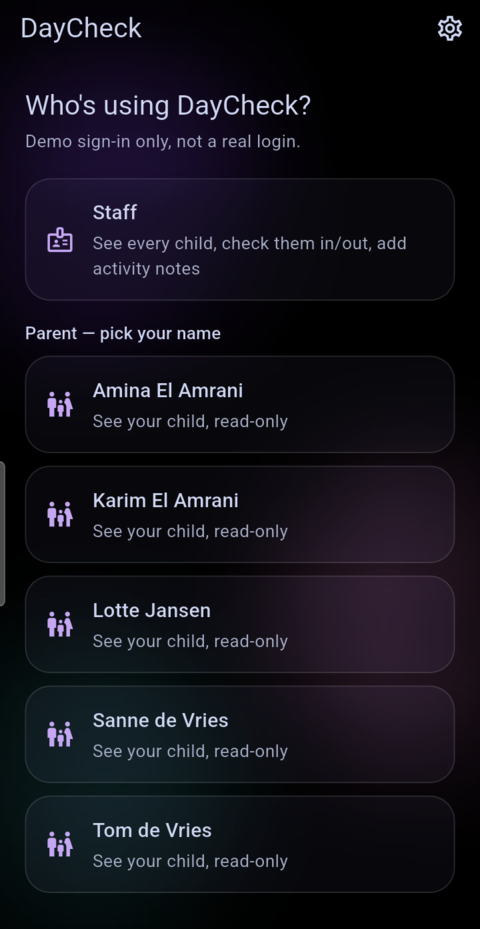
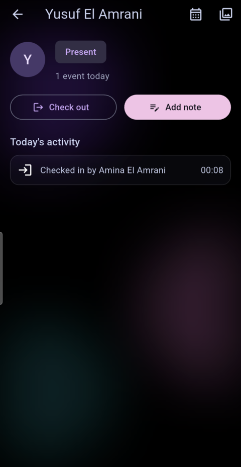

# Design

## Glassmorphism

Content sits on frosted-glass panels over soft colour shapes. Two widgets
in `core/widgets/glass.dart` make the whole look:

- `GlassBackground` paints a pastel gradient (light) or a dark base with
  faint shapes (dark), blurs the shapes, and provides a `BackdropGroup`.
- `GlassPanel` blurs what is behind it, adds a translucent fill, a light
  sheen from the top left, a thin bright border and a soft shadow. All
  panels on a screen share one blur pass through the `BackdropGroup`.

The same widgets and palette are used in my other Flutter app, MetJou, so
both apps share one visual language.

## Light and dark

The colours are Catppuccin: **Latte** for light mode, **Mocha** for dark.

| | Light (Latte) | Dark (Mocha) |
| --- | --- | --- |
| Glass | Mostly clear, white sheen and edge | Deep, strongly tinted |
| Background | Lavender, pink and blue gradient | Dark base with faint shapes |
| Text | Dark on light | Light on dark |

The theme follows the system by default. Settings can force light or
dark.

{ width="240" }
{ width="240" }

## Reduce effects

A backdrop blur is the most expensive thing the app draws. On an old
phone's GPU it is what makes scrolling stutter. With **Reduce effects**
on:

- panels are drawn solid, with no blur, at higher opacity so text stays
  readable;
- shadows are smaller;
- background shapes are radial gradients instead of a full-screen blur.

The layout and colours do not change, so the app still looks like
itself. The mode also turns on when the phone's high-contrast setting is
on. It is passed down the tree by a small `InheritedWidget`,
`GlassEffects`, so panels do not need to know about Settings.

## Right to left

Hebrew and Arabic lay the whole app out right to left: lists, app bars,
icons with a direction, and the photo viewer's panel. This comes from
Flutter's localization delegates once the locales are declared; the
widgets use start and end alignment, not left and right, so nothing has
to be special-cased.

## Photos

- In lists, photos are cropped to fill their tile and decoded at the
  size they are shown.
- The viewer shows the photo uncropped on black, with a glass panel for
  the time, author and description. A `Hero` animation carries the photo
  from its tile into the viewer.
