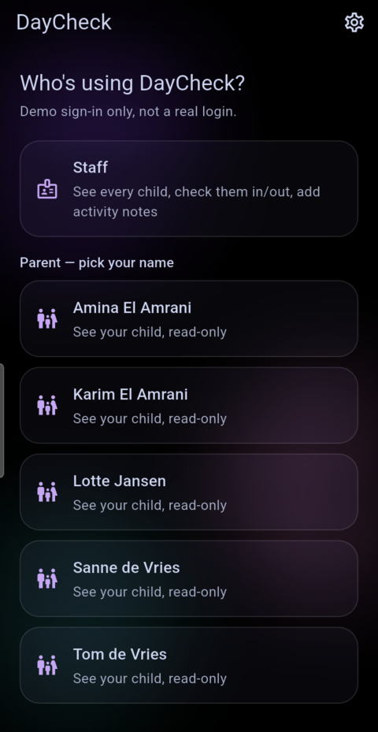
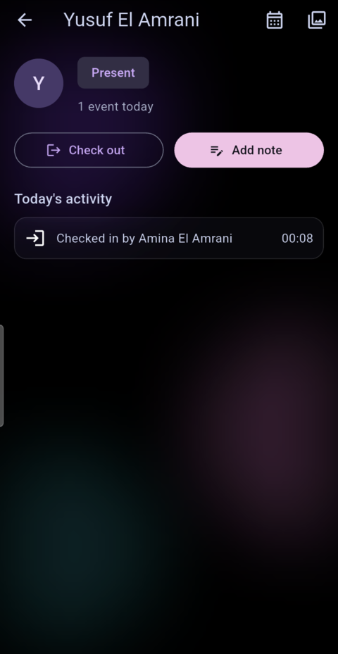
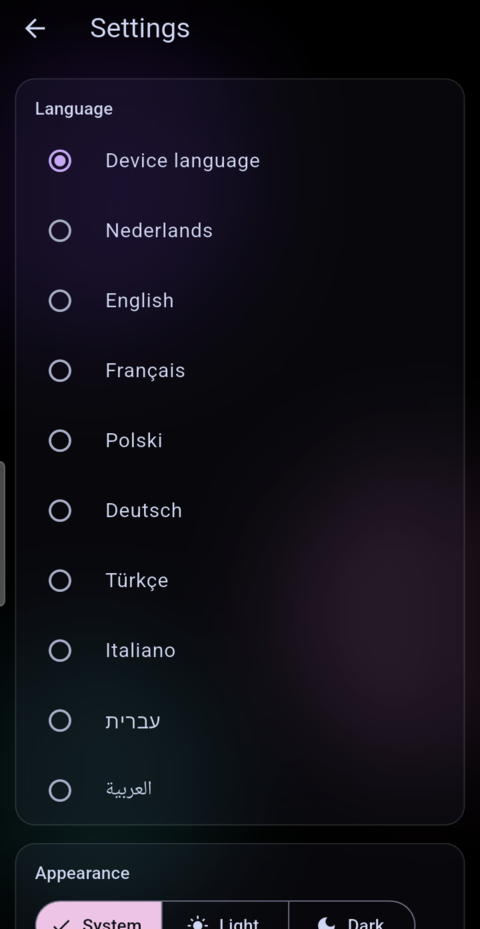

# DayCheck

DayCheck is a daycare app built in Flutter. Staff check children in and
out and share the day with parents through notes, photos and documents.
Parents follow their own child, get notified, and send leave or
extra-hours requests.

I built it to show how I work in Flutter: a clear MVVM architecture with
Riverpod, state that cannot go out of sync, tests for every ViewModel,
CI on every push, and a design that holds up in light and dark mode, in
nine languages, and on older phones.

{ width="240" }
{ width="240" }
{ width="240" }

## At a glance

| | |
| --- | --- |
| Platform | Android 7.0 (API 24) and up; Flutter also targets iOS, web and desktop |
| Architecture | Feature-first, MVVM per feature, Riverpod for state and dependency injection |
| Storage | Local first: `shared_preferences` plus the app's own folders for photos and PDFs |
| Languages | Dutch, English, French, Polish, German, Turkish, Italian, Hebrew, Arabic |
| Design | Glassmorphism on Catppuccin Latte (light) and Mocha (dark) |
| Quality | 49 tests, `flutter analyze` clean, CI on GitHub Actions |

## What is in this documentation

- [Features](features.md): what staff and parents can do.
- [Architecture](architecture.md): how the code is organised and why.
- [Design](design.md): the visual system and how it adapts.
- [Stack](stack.md): the packages used and what each one is for.
- [User feedback](user-feedback.md): complaints from public app reviews in
  this domain and how DayCheck answers them.
- [Development](development.md): running, testing, CI and adding a
  language.
