# Screens

Every screen in light and dark mode, rendered from the app with demo
data by `tool/screenshots/screenshots_test.dart` (see
[Development](development.md#screenshots)).

=== "Light"

    

    <figure markdown>
    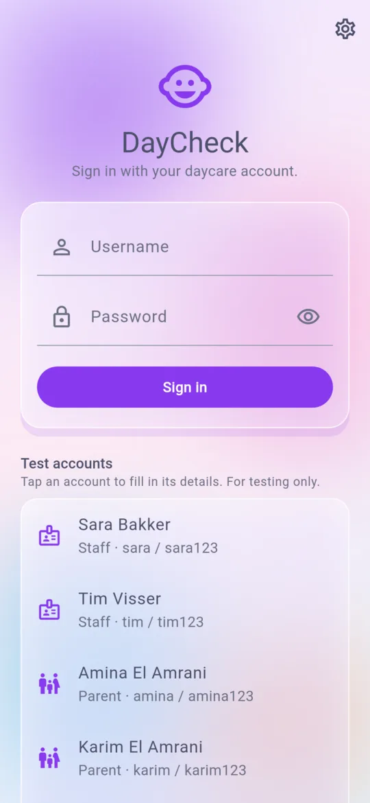{ width="230" loading=lazy }
    <figcaption>Login, with the test accounts listed</figcaption>
    </figure>

    <figure markdown>
    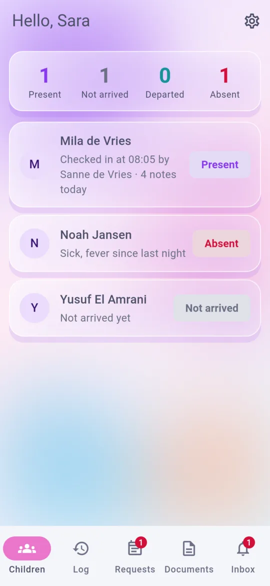{ width="230" loading=lazy }
    <figcaption>Staff home: attendance count and every child</figcaption>
    </figure>

    <figure markdown>
    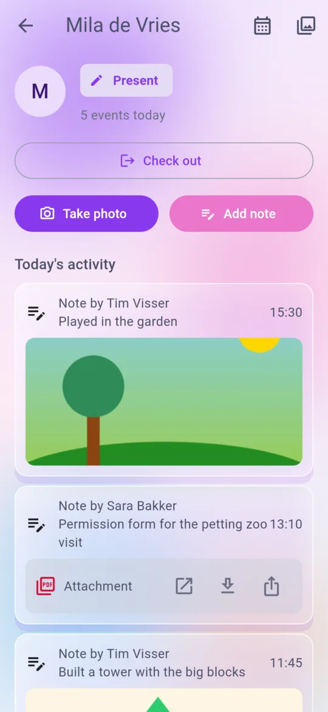{ width="230" loading=lazy }
    <figcaption>A child's day: status, take photo, notes, PDF</figcaption>
    </figure>

    <figure markdown>
    { width="230" loading=lazy }
    <figcaption>Tap the status: check in or out, absent, not arrived, undo</figcaption>
    </figure>

    <figure markdown>
    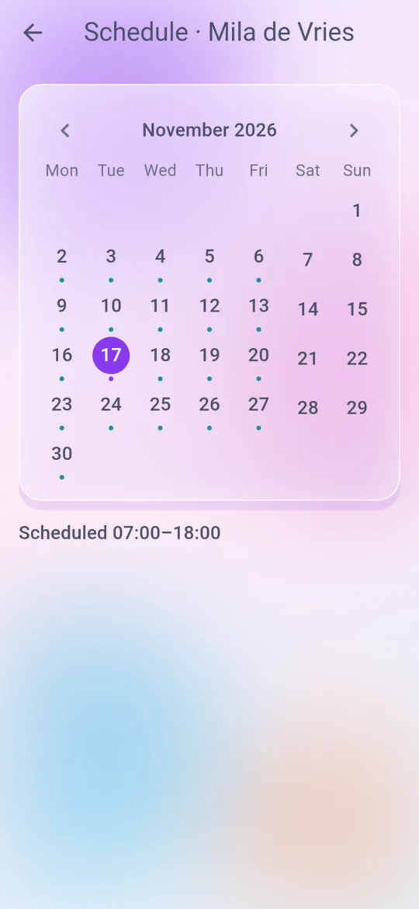{ width="230" loading=lazy }
    <figcaption>Schedule calendar</figcaption>
    </figure>

    <figure markdown>
    { width="230" loading=lazy }
    <figcaption>Today's log across all children</figcaption>
    </figure>

    <figure markdown>
    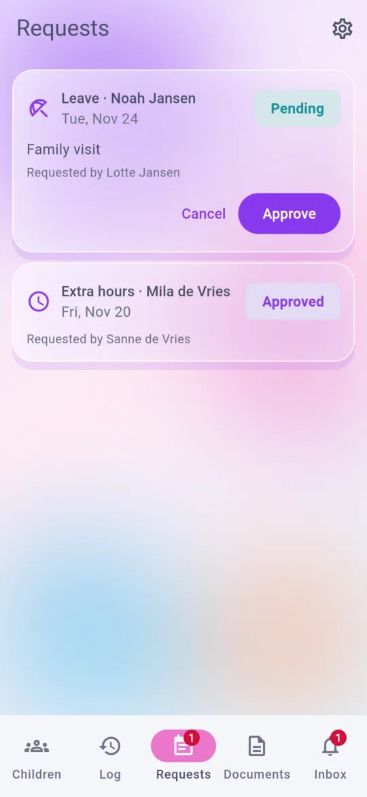{ width="230" loading=lazy }
    <figcaption>Requests to approve or cancel</figcaption>
    </figure>

    <figure markdown>
    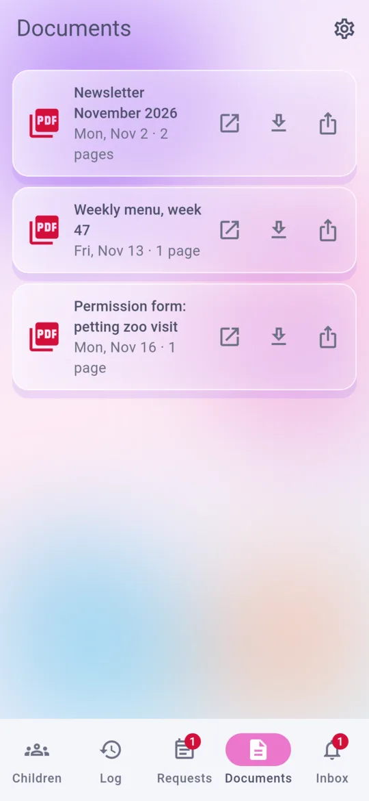{ width="230" loading=lazy }
    <figcaption>Documents: open, download, share</figcaption>
    </figure>

    <figure markdown>
    { width="230" loading=lazy }
    <figcaption>Staff inbox: new requests</figcaption>
    </figure>

    <figure markdown>
    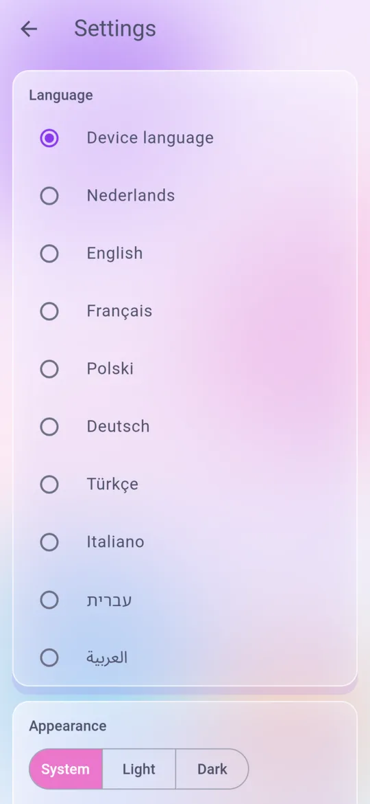{ width="230" loading=lazy }
    <figcaption>Settings: nine languages, theme, pop-ups, reduce effects</figcaption>
    </figure>

    <figure markdown>
    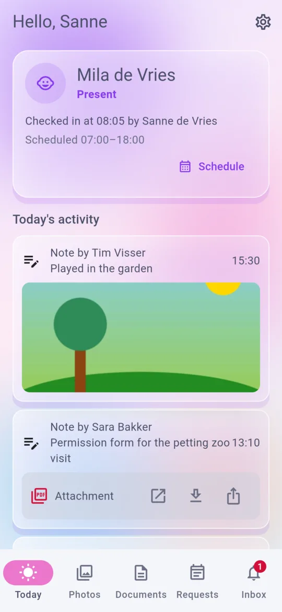{ width="230" loading=lazy }
    <figcaption>Parent home: where their child is and today's feed</figcaption>
    </figure>

    <figure markdown>
    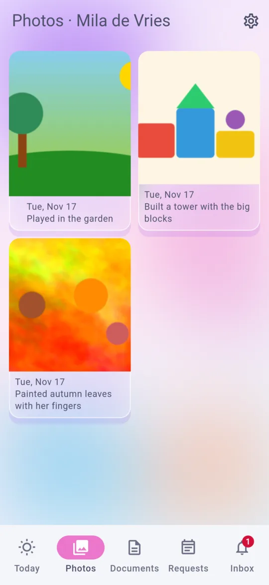{ width="230" loading=lazy }
    <figcaption>Photos of their own children only</figcaption>
    </figure>

    <figure markdown>
    { width="230" loading=lazy }
    <figcaption>Photo viewer with time, author and caption</figcaption>
    </figure>

    <figure markdown>
    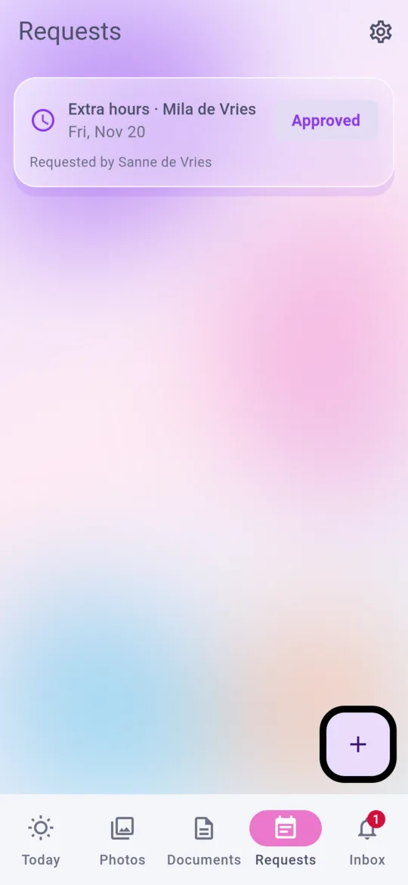{ width="230" loading=lazy }
    <figcaption>A parent's requests</figcaption>
    </figure>

    <figure markdown>
    { width="230" loading=lazy }
    <figcaption>Parent inbox, per account</figcaption>
    </figure>

    

=== "Dark"

    

    <figure markdown>
    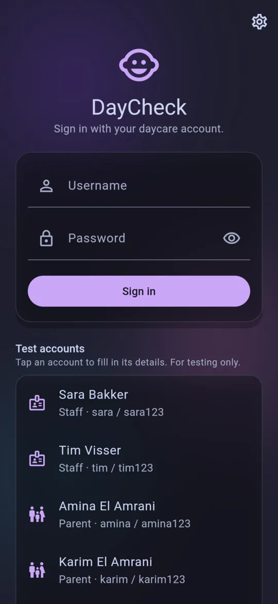{ width="230" loading=lazy }
    <figcaption>Login, with the test accounts listed</figcaption>
    </figure>

    <figure markdown>
    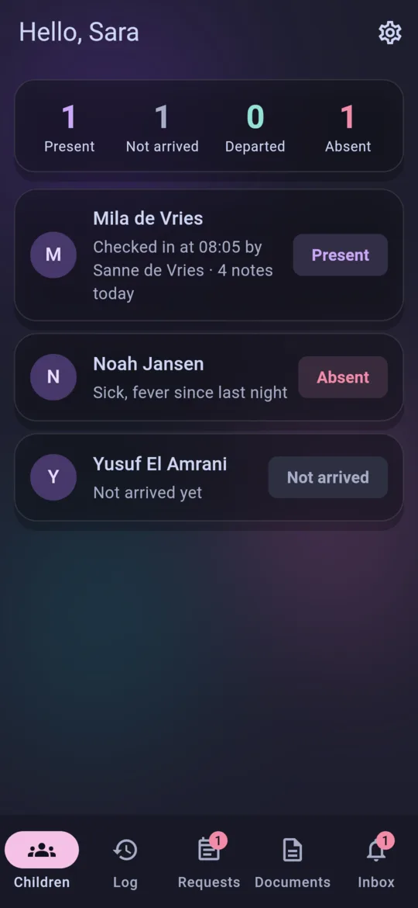{ width="230" loading=lazy }
    <figcaption>Staff home: attendance count and every child</figcaption>
    </figure>

    <figure markdown>
    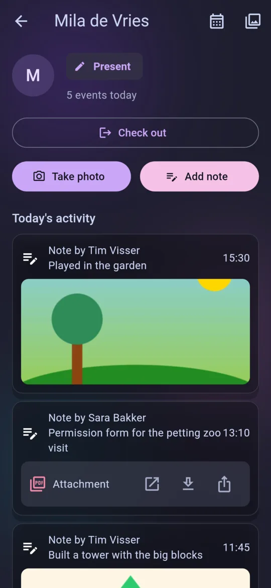{ width="230" loading=lazy }
    <figcaption>A child's day: status, take photo, notes, PDF</figcaption>
    </figure>

    <figure markdown>
    { width="230" loading=lazy }
    <figcaption>Tap the status: check in or out, absent, not arrived, undo</figcaption>
    </figure>

    <figure markdown>
    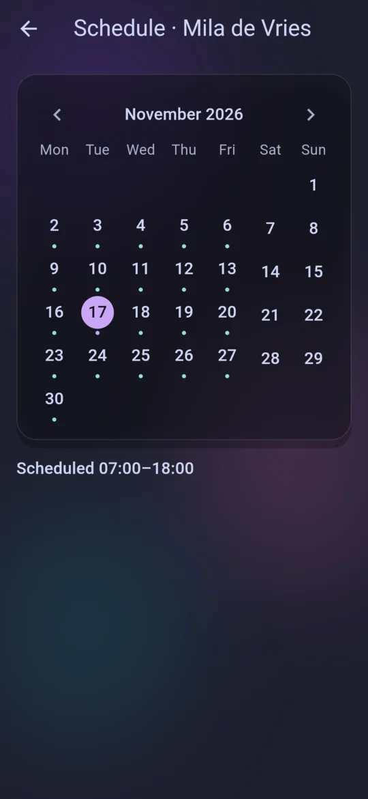{ width="230" loading=lazy }
    <figcaption>Schedule calendar</figcaption>
    </figure>

    <figure markdown>
    { width="230" loading=lazy }
    <figcaption>Today's log across all children</figcaption>
    </figure>

    <figure markdown>
    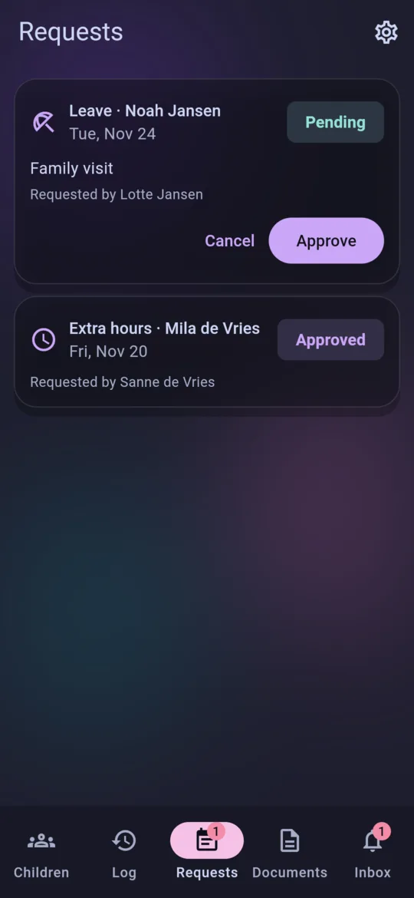{ width="230" loading=lazy }
    <figcaption>Requests to approve or cancel</figcaption>
    </figure>

    <figure markdown>
    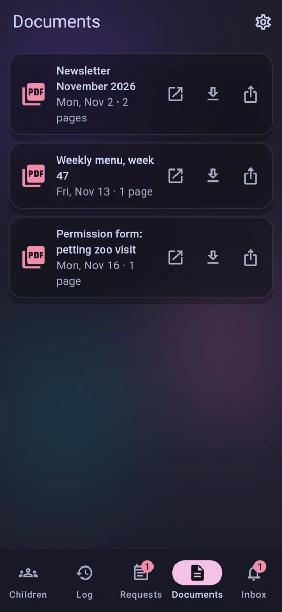{ width="230" loading=lazy }
    <figcaption>Documents: open, download, share</figcaption>
    </figure>

    <figure markdown>
    { width="230" loading=lazy }
    <figcaption>Staff inbox: new requests</figcaption>
    </figure>

    <figure markdown>
    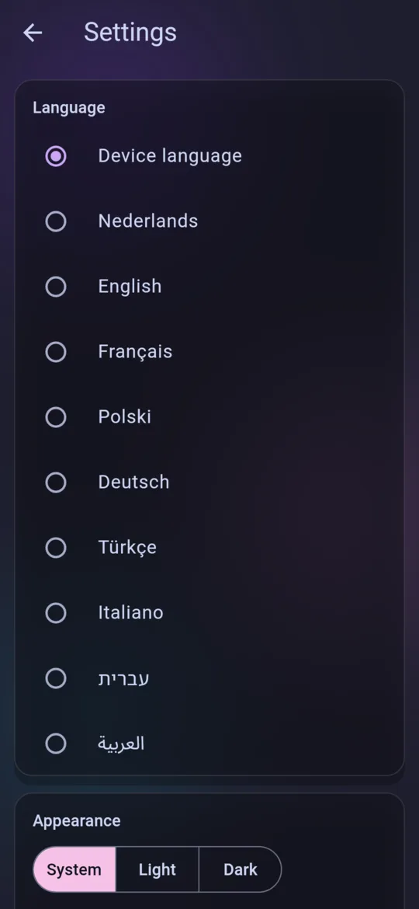{ width="230" loading=lazy }
    <figcaption>Settings: nine languages, theme, pop-ups, reduce effects</figcaption>
    </figure>

    <figure markdown>
    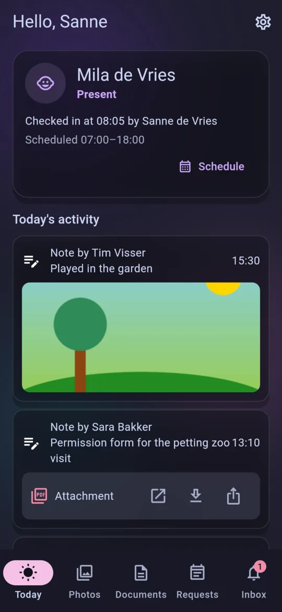{ width="230" loading=lazy }
    <figcaption>Parent home: where their child is and today's feed</figcaption>
    </figure>

    <figure markdown>
    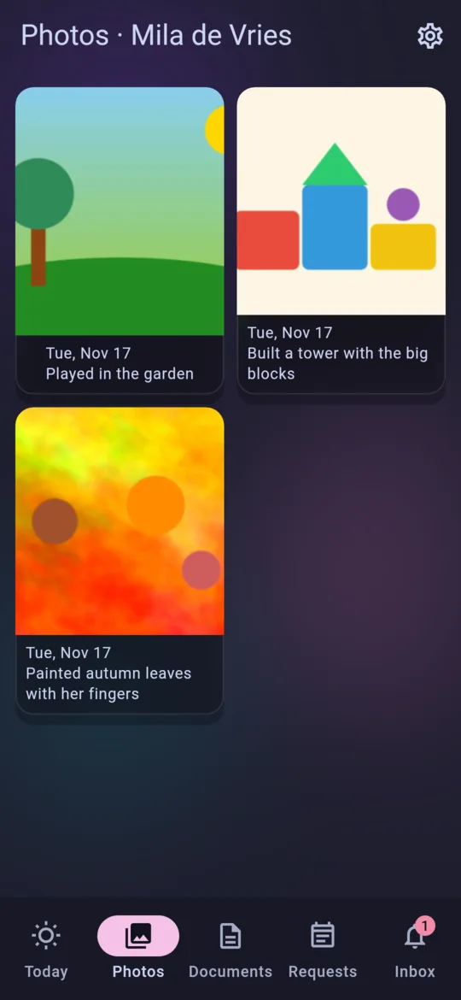{ width="230" loading=lazy }
    <figcaption>Photos of their own children only</figcaption>
    </figure>

    <figure markdown>
    { width="230" loading=lazy }
    <figcaption>Photo viewer with time, author and caption</figcaption>
    </figure>

    <figure markdown>
    { width="230" loading=lazy }
    <figcaption>A parent's requests</figcaption>
    </figure>

    <figure markdown>
    { width="230" loading=lazy }
    <figcaption>Parent inbox, per account</figcaption>
    </figure>

    

